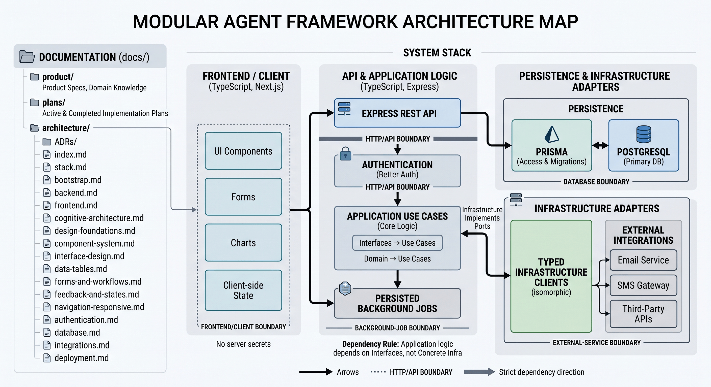

# CognitiveStack

<p align="center">
  
</p>

Software engineering specifications, prompt architectures, and modular skills for building
agentic systems.

`agent-skills` · `prompt-engineering` · `system-architecture` · `llm` · `workflows`

## What It Is

CognitiveStack is a Markdown knowledge system that a project installs next to its code, so
AI agents know how to work before they change anything.

It is not a code starter and not a library. It is the context layer: engineering
specifications, architectural boundaries, interface criteria, quality and security rules,
and reusable skills, written so that Codex, Claude, GitHub Copilot, or any other agent read
the same thing and reach the same decisions.

It works with [OpenSpec](https://github.com/Fission-AI/OpenSpec) under one rule:
**CognitiveStack governs engineering. OpenSpec governs change.** CognitiveStack defines how
agents build; OpenSpec defines what is being changed, from the proposal to the archived
record of what shipped.

## Why It Exists

An agent writes code quickly, but without persistent context it tends to:

- invent a different pattern in every module;
- mix business rules with infrastructure;
- duplicate components and documentation;
- build interfaces straight from the database schema;
- expose technical detail on screen;
- skip states, permissions, tests, or migrations;
- rely on conversations the next agent never saw.

CognitiveStack turns those decisions into versioned, navigable, verifiable instructions
inside the repository itself.

## What It Contains

| Area           | Context included                                             |
| -------------- | ------------------------------------------------------------ |
| Agents         | Instructions for Codex, Claude, and GitHub Copilot           |
| Architecture   | Express.js, Next.js, layer boundaries, and integrations      |
| Data           | PostgreSQL, Prisma, and versioned migrations                 |
| Integrity      | Idempotency, concurrency, constraints, and webhooks          |
| Authentication | Better Auth, and rules against reinventing sessions          |
| Frontend       | shadcn/ui, Tailwind, shared forms, tables, and states        |
| UX criteria    | Screen brief, information tiers, and action budgets          |
| Visual design  | Tokens and scales for spacing, type, color, and motion       |
| Video          | Problem storytelling, flat isometric style, and micro-motion |
| Quality        | Definition of Done, testing, code review, and observability  |
| Performance    | Budgets, measurement, and anti-patterns                      |
| Security       | Object-level access, tenant isolation, and hardening         |
| Changes        | OpenSpec lifecycle from proposal to archived behavior        |
| Execution      | Decisions, specialist skills, and technical debt             |
| Delivery       | Small commits, descriptive messages, and pull requests       |

### Skills

Procedures loaded only when a task needs them. Workflow skills control the process;
specialist skills control the disciplines.

- **Workflow**, generated by OpenSpec: `explore` · `propose` · `update` · `apply` · `verify`
  · `sync` · `archive`
- **Specialist**, in `.agents/skills/`: `implement-operational-frontend` · `create-migration`
  · `review-code` · `harden-security` · `optimize-performance` · `update-documentation`
  · `commit-changes`

## Reference Stack

Node.js and TypeScript, Express.js for the REST API, Next.js and React on the frontend,
Better Auth for identity and sessions, PostgreSQL with Prisma, Tailwind CSS and shadcn/ui,
React Hook Form with Zod, Axios for server-side integrations, pnpm through Corepack, and
Docker for deployment.

The stack is a default decision, not an irreversible constraint. A project that needs to
deviate records the reason and its consequences in an ADR.

## How The Context Works

```text
AGENTS.md
  -> states what to read and how to work
ARCHITECTURE.md
  -> shows components, boundaries, and dependencies
docs/product/
  -> explains what the product must do
docs/architecture/
  -> explains how it must be built
openspec/
  -> specifies current behavior and the changes in progress
.agents/skills/
  -> runs repeatable procedures
docs/quality/ + docs/security/
  -> defines when a change is acceptable
```

Every non-trivial behavior change runs through one lifecycle:

```text
explore -> propose -> review -> apply -> verify -> archive
```

OpenSpec writes the proposal, specs, design, and tasks; `openspec/config.yaml` requires each
design to answer CognitiveStack's screen and sensitive-operation briefs; each task runs
through the specialist skill for its discipline; and archiving merges the shipped behavior
into `openspec/specs/`.

The point is not to load the whole repository into every prompt. An agent starts from a
small map and opens only the source of truth the task requires.

## Backend Criteria

The backend rules assume the frontend is fully controlled by an attacker. Knowing an
identifier is never authorization, and a request that arrives twice must not act twice:

- derive identity, tenant, and role from the session, never from the request;
- scope every private query by tenant and ownership, including updates, deletes, and referenced IDs;
- accept only allowlisted fields on every write;
- answer `404` for anything outside the caller's tenant;
- make side effects idempotent, with keys scoped by tenant, user, and operation and claimed atomically;
- enforce critical invariants with database constraints, guarded updates, and transactions;
- verify and deduplicate webhooks, and treat every job as at-least-once;
- test cross-tenant access, ID tampering, mass assignment, replays, and races with two tenants or more.

## Interface Criteria

The interface rules keep an operational panel from becoming a pile of cards, filters, and
messages. Designing is deciding what does not appear:

- answer in writing who uses the screen, what they decide, with what information, and what
  their single primary action is, before implementing it;
- design from the user's job, never from the database schema;
- never show a value only because the backend returns it;
- tier information P0 to P3, and keep technical detail out of the initial view;
- limit simultaneous actions: one primary, one or two secondary, the rest disclosed;
- choose each control from the user's intent, not the data type: steppers, sliders, segmented
  controls, selection cards, chips, and searchable comboboxes each fit a different task;
- avoid both under-designed forms of generic inputs and over-designed custom widgets;
- take spacing, type, color, radius, and motion values from documented scales;
- cover every state: loading, empty, partial, error, permission, and success;
- verify keyboard, mobile, light, and dark before calling anything done.

## Repository Map

```text
.
├── AGENTS.md                       # Permanent rules for agents
├── ARCHITECTURE.md                 # High-level technical map
├── CLAUDE.md                       # Entry point for Claude
├── .agents/skills/                 # Specialist and OpenSpec skills
├── .claude/                        # OpenSpec skills and commands for Claude Code
├── .github/                        # Copilot instructions, skills, and prompts
├── .codex/                         # Configuration, not product knowledge
├── openspec/
│   ├── config.yaml                 # Bridge from OpenSpec to CognitiveStack
│   ├── specs/                      # Current behavior
│   └── changes/                    # Changes in progress and their archive
└── docs/
    ├── product/                    # Purpose, users, domain, and vocabulary
    ├── architecture/               # Stack, boundaries, and patterns
    ├── quality/                    # Change lifecycle, testing, review, commits, debt, done
    ├── security/                   # Principles, hardening, and threats
    ├── video/                      # Storytelling, isometric style, type, motion, production
    └── generated/                  # Derived references
```
